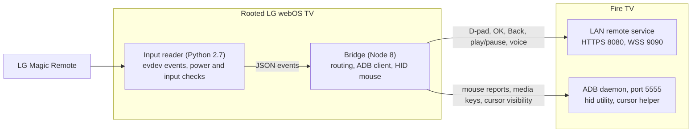

# lg-magic-fire

[](https://github.com/mgd34msu/lg-magic-fire/actions/workflows/checks.yml)
[](LICENSE)

Use an **LG Magic Remote as a mouse, remote, and Alexa microphone for a Fire TV** plugged into a rooted LG webOS TV.

- **Native cursor.** Pointer movement, wheel, and click arrive on Fire TV as a real HID mouse, with drag support.
- **Remote buttons.** D-pad, OK, Back, and media keys control Fire TV.
- **Voice.** Hold the microphone button to talk to Alexa.
- **LG stays in charge of the TV.** Home, Input, volume, mute, and every LG menu keep working natively.
- **Scoped to one HDMI input.** The bridge forwards only while the TV is awake on the Fire TV input. It never wakes the TV or switches inputs.

The bridge runs entirely on the TV. A computer is needed only to install and maintain it. Fire TV needs network ADB debugging, but not root.

> [!WARNING]
> Experimental and hardware-specific. This project relies on undocumented LG services and Fire TV LAN protocols that can change with firmware. It does not root either device.

| Device | Tested with |
| --- | --- |
| LG TV | 86NANO90UNA, webOS 5.6.2 |
| Remote | Magic Remote MR20 |
| Fire TV | Fire TV Cube (AFTGAZL), Fire OS 7.7.1.7 / Android 9 |

Other models and firmware versions are unverified. [Compatibility reports](#reporting-a-problem) are welcome.

## Contents

- [Overview](#overview)
- [Controls](#controls)
- [When forwarding is active](#when-forwarding-is-active)
- [Requirements](#requirements)
- [Quick start](#quick-start)
- [Installation, step by step](#installation-step-by-step)
- [Configuration](#configuration)
- [Commands](#commands)
- [Troubleshooting](#troubleshooting)
- [Updating](#updating)
- [Disable or uninstall](#disable-or-uninstall)
- [How it works](#how-it-works)
- [Development](#development)
- [Security and privacy](#security-and-privacy)
- [References and license](#references-and-license)

## Overview



A Python reader on the TV reads the remote's input devices and continuously checks that the TV is awake on the configured HDMI input with no LG menu open. A Node bridge turns those events into Fire TV input over two channels: the paired LAN remote service for navigation and voice, and ADB for the mouse. See [How it works](#how-it-works) for details.

## Controls

While forwarding is active:

| Remote control | Behavior |
| --- | --- |
| Pointer movement | Moves Fire TV's native mouse cursor; speed is set by `pointer_gain` |
| Wheel | Scrolls as a mouse wheel |
| Pointer click | Left mouse button; hold to drag where the app supports it |
| D-pad / OK | Fire TV navigation / select |
| Back | Fire TV back |
| Play/pause and other media keys | Fire TV play, pause, stop, rewind, fast-forward, previous, and next, on remotes that have them |
| Microphone | Hold to speak to Alexa, release to submit; 20-second maximum |
| Volume / mute | Controls the LG TV; forwarding continues |
| Home | Opens LG Home; a custom [lginputhook](https://github.com/Simon34545/lginputhook) action for Home is preserved |
| Input | Opens the LG input picker |
| Netflix / Prime Video | Launches the LG app |
| Any other button | Goes to LG; standard key codes are replayed there so the press is not lost |

Home, Input, the app buttons, and any other LG-bound button release the remote first, so the menu that opens gets native LG navigation. Forwarding resumes when that menu closes. If the button opened nothing, forwarding resumes after your next OK, Back, click, or Input press, which LG receives.

Things to know:

- The cursor hides after `cursor_idle_seconds` (5 by default) without pointer movement, wheel, or click. D-pad presses do not extend the timer. Hiding the cursor does not disconnect anything.
- The remote reports motion, not whether it is aimed at the screen. Moving it while pointed away still moves the cursor.
- Mouse support varies by Fire TV app. Some interfaces need the D-pad even when the cursor is visible.

## When forwarding is active

The bridge forwards input only when **all** of these hold:

- The LG TV reports its power state as `Active`.
- The configured HDMI app is in the foreground and its physical input is active.
- No LG menu or overlay owns the screen.
- That state was confirmed less than 1.5 seconds ago.

Anything else, including a failed or stale state query, disables forwarding and returns the remote to LG.

| Situation | What the bridge does |
| --- | --- |
| TV boot or bridge restart | Starts listening and waits; sends nothing to Fire TV |
| Awake on the configured input, no session yet | Waits for pointer movement, a Fire TV button, or the microphone |
| First remote activity on that input | Checks the paired LAN service, opens ADB, registers the mouse, starts the cursor helper |
| Other input, LG menu, standby, or screen off | Cancels pending work, closes Fire TV connections, removes the mouse, releases input capture |
| Fire TV connection failure | Keeps listening; later remote activity retries after a 5-second cooldown |

Input queued before leaving the input or entering standby is discarded. Returning starts a new session on new remote activity, so the first action can take a moment while the mouse and cursor helper connect.

The running bridge never launches the Fire TV remote service through DIAL (`POST /apps/FireTVRemote`), because that request can trigger HDMI-CEC input switching and wake the TV. Activation happens only during [explicit pairing](#3-pair-with-fire-tv).

## Requirements

| Component | Needs |
| --- | --- |
| LG TV | Rooted webOS with root SSH (for example through [webOS Homebrew](https://www.webosbrew.org/)), Python 2.7, Node 8.12+, `luna-send`, and readable `LGE M-RCU` evdev devices |
| Fire TV | Network ADB debugging enabled, `/system/bin/hid`, and `app_process`; the cursor helper targets Android 9 / API 28+ |
| Installation computer | Git, Python 3.9+, Node/npm, OpenSSH, and Android platform tools (`adb`) |
| Network | Both devices reachable from the computer, and Fire TV reachable from the TV, on a trusted LAN |
| Boot startup (optional) | An existing `/var/lib/webosbrew/init.d/` directory on the TV; otherwise use test mode |

The Python tools use only the standard library. The single JavaScript dependency is a pinned `ws`, installed on the computer and copied to the TV. A prebuilt cursor helper is checked in, so installation needs no JDK or Android SDK. On the TV, the service runs `/usr/bin/node` and `python`.

Fire TV ports used:

| Port | Purpose |
| --- | --- |
| `8009` | Activates the LAN remote service, during explicit pairing only |
| `8080` | Pairing, remote commands, status, and voice session control (HTTPS) |
| `9090` | Microphone audio (secure WebSocket) |
| `5555` | ADB: mouse reports, media keys, cursor helper, deployment; change with `adb_port` |

Keep SSH, ADB, and the remote service on a private LAN and off the internet.

## Quick start

Run on the installation computer. Each step is explained under [Installation, step by step](#installation-step-by-step).

```sh
git clone https://github.com/mgd34msu/lg-magic-fire.git
cd lg-magic-fire
npm ci --prefix standalone --ignore-scripts
cp settings.example.json settings.json   # edit: TV address, Fire TV address, HDMI port

ssh root@YOUR_TV_IP exit                 # root SSH must work without a prompt
python3 magic_fire.py setup              # enter the PIN that Fire TV displays
adb connect YOUR_FIRE_TV_IP:5555         # accept the prompt on Fire TV

python3 deploy.py --test                 # install and start, boot startup off
python3 deploy.py                        # after verifying: boot startup on
```

After `deploy.py --test`, select the Fire TV input, move the pointer, and accept the **second** ADB prompt on Fire TV. That one authorizes the bridge's own key.

## Installation, step by step

### 1. Get the project and configure it

```sh
git clone https://github.com/mgd34msu/lg-magic-fire.git
cd lg-magic-fire
npm ci --prefix standalone --ignore-scripts
cp settings.example.json settings.json
```

Edit `settings.json` with the TV address, the Fire TV address, and the physical HDMI port that Fire TV is plugged into (default: HDMI 3). All settings are listed under [Configuration](#configuration).

Check your settings without contacting either device:

```sh
python3 magic_fire.py config
python3 deploy.py --test --dry-run
```

`config` prints the validated settings plus the derived HDMI app ID, such as `com.webos.app.hdmi3`. The dry run prints the deployment plan. Neither checks SSH, ADB, credentials, or hardware.

### 2. Verify root SSH to the TV

```sh
ssh root@YOUR_TV_IP
```

Exit the TV shell before continuing. The tools run SSH with `BatchMode=yes`, so they cannot prompt for a password. An installed SSH key just works. With password authentication, open a reusable control connection first:

```sh
export MAGIC_FIRE_SSH_CONTROL="${TMPDIR:-/tmp}/lg-magic-fire-ssh"
ssh -M -S "$MAGIC_FIRE_SSH_CONTROL" -o ControlPersist=600 -fnNT root@YOUR_TV_IP
```

Run later commands in the same terminal so they inherit `MAGIC_FIRE_SSH_CONTROL`, and reopen the connection if it expires.

### 3. Pair with Fire TV

```sh
python3 magic_fire.py setup
```

Fire TV shows a four-digit PIN. Type it at the hidden prompt. Setup creates two private items under `.state/`, both excluded from Git:

- `firetv.json`: the Fire TV address and its LAN remote pairing token.
- `tv-adbkey` and `tv-adbkey.pub`: a dedicated ADB key pair for the bridge on the TV.

Keep `.state/` private and keep it around; later deployments reuse it. Running `setup` again changes nothing when credentials exist. To replace the pairing on purpose:

```sh
python3 magic_fire.py setup --pair
```

Then redeploy so the TV receives the new token. Restarting the service does not copy it.

### 4. Authorize ADB and deploy in test mode

Enable ADB debugging on Fire TV, then connect from the computer and accept the prompt on Fire TV:

```sh
adb connect YOUR_FIRE_TV_IP:5555
adb devices    # the Fire TV should be listed as "device"
```

Deploy:

```sh
python3 deploy.py --test
```

This pushes the cursor helper to Fire TV, stops any running bridge, installs the runtime and credentials on the TV, and starts the listener. **Test mode runs the real bridge but leaves boot startup off**, removing this project's boot hook if one exists.

Now select the Fire TV input and move the pointer. Fire TV shows a **separate ADB prompt for the bridge's key**; authorizing the computer earlier does not cover it. Choose "Always allow" so the bridge can reconnect unattended. The bridge waits up to 60 seconds for the answer. If it times out, wait 5 seconds and use the remote again.

### 5. Verify on your hardware

On the Fire TV input, with LG menus closed, check:

- Pointer movement, wheel, click, and the cursor hiding after inactivity.
- D-pad, OK, and Back.
- Hold-to-talk, then release to submit to Alexa.
- Home and Input returning navigation to LG.
- Volume and mute still controlling the TV.

Then check that the bridge leaves the TV alone:

1. Switch to another HDMI input, use the remote there, and wait 30 seconds. The TV should stay on that input with normal LG navigation.
2. Turn the TV off for 30 seconds. It should stay off.
3. Turn it on, select the Fire TV input, and use the remote. Forwarding should resume.

Deployment sends no test presses and the automated tests are mocked, so this manual pass is the only real hardware check.

Inspect the service from the computer:

```sh
python3 magic_fire.py status
python3 magic_fire.py logs --lines 50
```

An idle listener with no Fire TV connection is normal. A running supervisor does not mean a session is up; the [log](#reading-the-log) tells you.

### 6. Enable startup at boot

```sh
python3 deploy.py
```

This redeploys, restarts the service, and installs `/var/lib/webosbrew/init.d/magic-fire`. That directory must already exist in your rooting setup. If it does not, stay on `--test` and start the service manually when needed.

From here on the bridge needs no computer and no open SSH session.

## Configuration

`settings.json`, copied from [settings.example.json](settings.example.json):

```json
{
  "tv_host": "192.168.1.50",
  "fire_tv_host": "192.168.1.51",
  "hdmi_input": 3,
  "pointer_gain": 0.6,
  "adb_port": 5555,
  "cursor_idle_seconds": 5
}
```

| Setting | Default | Meaning |
| --- | --- | --- |
| `tv_host` | Required | LG TV host name or IP address, used for root SSH |
| `fire_tv_host` | Required | Fire TV host name or IP address; pair again after changing it |
| `hdmi_input` | `3` | Physical HDMI port connected to Fire TV, `1` to `4` |
| `pointer_gain` | `0.6` | Pointer speed, `0.1` to `2`; lower is slower |
| `adb_port` | `5555` | Fire TV network ADB port, `1` to `65535` |
| `cursor_idle_seconds` | `5` | Seconds without pointer activity before the cursor hides, `1` to `3600` |

Hosts take no URL scheme and no port. Unknown keys, wrong types, and out-of-range values are rejected by both the Python and JavaScript sides.

**Choosing a settings file.** The tools look for, in order: the `--settings PATH` argument, the `MAGIC_FIRE_SETTINGS` environment variable, then `settings.json` in the repository. With `magic_fire.py`, global options go before the subcommand:

```sh
python3 magic_fire.py --settings /path/to/living-room.json config
python3 deploy.py --settings /path/to/living-room.json --test --dry-run
```

**Applying changes.** Settings are read at startup. Edit the local file and redeploy with `python3 deploy.py` (boot startup on) or `python3 deploy.py --test` (boot startup off). A plain stop and start only rereads the copy already on the TV.

**If the Fire TV address changes.** Update `fire_tv_host`, run `python3 magic_fire.py setup --pair`, and redeploy. A DHCP reservation avoids this.

## Commands

| Command | What it does |
| --- | --- |
| `python3 magic_fire.py config` | Validates and prints local settings; contacts no device |
| `python3 magic_fire.py setup` | Creates the bridge ADB key and pairs with Fire TV, if either is missing |
| `python3 magic_fire.py setup --pair` | Replaces the saved pairing token; keeps the ADB key |
| `python3 deploy.py --test --dry-run` | Validates settings and prints the plan; contacts no device |
| `python3 deploy.py --test` | Installs or updates, starts now, boot startup off |
| `python3 deploy.py` | Installs or updates, starts now, boot startup on |
| `python3 magic_fire.py status` | Prints the TV supervisor state and Fire TV's LAN remote status |
| `python3 magic_fire.py logs --lines 50` | Shows recent bridge output; default 30 lines, up to 1000 |
| `python3 magic_fire.py start` | Starts the installed service; copies nothing and leaves the boot hook alone |
| `python3 magic_fire.py stop` | Stops the supervisor and bridge |
| `python3 magic_fire.py capture --seconds 30` | Prints raw remote events without intercepting them; up to 300 seconds |

There is no `restart`; run `stop`, then `start`.

`status` makes two independent checks. Fire TV can answer while the bridge is stopped, and the supervisor can be running while a session is failing, so confirm readiness in the log. `magic_fire.py` also accepts `--tv HOST` to override the SSH target and `--state PATH` to choose the pairing file. `deploy.py` always uses `.state/` in the repository.

### Reading the log

| Log text | Meaning |
| --- | --- |
| `Magic Fire listening; waiting for remote activity on an awake HDMI ...` | Listener started; no Fire TV session yet |
| `Waiting for Fire TV to authorize the TV bridge key.` | Accept the bridge's ADB prompt on Fire TV |
| `Fire TV cursor active on HDMI ...` | Mouse and cursor helper are ready |
| `Alexa listening` / `Alexa session ended (...)` | A voice session started or ended; the reason is in parentheses |
| `LG controls restored; Fire TV connections closed` | A session closed, either normally on leaving the input or after an error |
| `Fire TV session: ...` | A connection or forwarding error ended the session; retry with the remote after 5 seconds |
| `Stopping: ...` | The bridge is exiting; the supervisor restarts it after 5 seconds |

### Where things live

| Location | Contents |
| --- | --- |
| `.state/` on the computer | Pairing credentials and the bridge's ADB key pair |
| `/media/developer/magic-fire/` on the TV | Runtime code, `ws`, installed settings, pairing token, ADB key |
| `/var/lib/webosbrew/init.d/magic-fire` on the TV | Boot startup script, when enabled |
| `/tmp/magic-fire.log` on the TV | Supervisor and bridge output |
| `/tmp/magic-fire-supervisor.pid`, `/tmp/magic-fire-node.pid` on the TV | Process IDs |
| `/tmp/magic-fire-diagnostics/` on the TV | Files staged by `capture` |
| `/data/local/tmp/lg-magic-fire-cursor.jar` on Fire TV | Cursor visibility helper |

## Troubleshooting

Start with `python3 magic_fire.py logs --lines 100`. The error text usually says whether the problem is SSH, the LAN remote service, ADB, or input capture.

| Symptom or message | What to do |
| --- | --- |
| Settings file missing or invalid | Copy the example, fix the JSON, and run `magic_fire.py config`. Unknown keys are rejected. |
| SSH permission denied, or a command hangs on a prompt | Confirm `ssh root@YOUR_TV_IP` works. Install a key, or open the [control connection](#2-verify-root-ssh-to-the-tv) in the same terminal. |
| `Missing deployment input` | Run `npm ci --prefix standalone --ignore-scripts` and `magic_fire.py setup`. |
| Deployment cannot find `.state/firetv.json` | Run `magic_fire.py setup` first. |
| Credentials belong to another Fire TV | Fix `fire_tv_host`, then run `magic_fire.py setup --pair`. |
| `An unrelated magic-fire boot script already exists` | Another script occupies `/var/lib/webosbrew/init.d/magic-fire`. Move it aside and redeploy. |
| `deploy.py` fails while writing the boot script | `/var/lib/webosbrew/init.d/` is missing. The service was left stopped; run `deploy.py --test` instead. |
| Pairing fails, or `Fire TV HTTP ...` errors | Check that Fire TV is reachable on its [ports](#requirements). If the service needs activating or the token replacing, run `setup --pair` and redeploy. The running bridge never activates it. |
| ADB `unauthorized`, or authorization times out | Accept the right key on Fire TV; the computer and the bridge use different keys. Check `adb_port` and that ADB debugging is on, wait 5 seconds, then use the remote. |
| `Fire TV mouse did not register` | Check ADB connectivity and that `/system/bin/hid` exists on this Fire OS version. |
| `Cursor visibility helper did not start` | Redeploy to push the JAR again; check `app_process` and the Android API level. |
| `No Magic Remote input devices found` | Confirm root access and that the remote appears as `LGE M-RCU` event devices. |
| Listener running, but no cursor | Turn the TV on, select the configured HDMI port, close LG menus, then move the pointer or press a button. An idle listener never connects by itself. |
| Forwarding stops on the right input | See [When forwarding is active](#when-forwarding-is-active); standby, screen off, and failed state queries all disable it. |
| TV wakes up or jumps to Fire TV by itself | Redeploy to make sure the TV runs the current bridge, which sends no DIAL launch. If it persists, check the log for repeated exits and [report it](#reporting-a-problem). |
| Cursor moves, but clicks do nothing | Use the D-pad. Mouse support depends on the Fire TV app. |
| Repeated disconnects or bridge exits | Read the log line before each one; check network stability and ADB authorization. |

To see what the remote sends without intercepting anything:

```sh
python3 magic_fire.py capture --seconds 30
```

Capture streams event records to the terminal. It never grabs the remote and never opens the microphone.

### Reporting a problem

Include the TV and remote models, webOS version, Fire TV model and Fire OS version, the HDMI port, whether an LG menu was open, steps to reproduce, and the relevant log lines. See [CONTRIBUTING.md](CONTRIBUTING.md).

Never attach `.state/`, your settings, pairing tokens, ADB keys, audio, or raw captures. Captures record your button presses, so redact them first.

## Updating

```sh
git pull --ff-only
npm ci --prefix standalone --ignore-scripts
python3 deploy.py --test
```

Repeat the [hardware checks](#5-verify-on-your-hardware), then run `python3 deploy.py` if you want boot startup. Settings and `.state/` credentials are reused; `setup` is needed only when credentials are missing or the pairing must be replaced.

## Disable or uninstall

Stop until the next TV reboot, from the computer:

```sh
python3 magic_fire.py stop
```

Stop and disable boot startup, **on the TV**:

```sh
sh /media/developer/magic-fire/service.sh stop
rm -f /var/lib/webosbrew/init.d/magic-fire
```

Remove the runtime as well, **on the TV**, after the two commands above:

```sh
rm -rf /media/developer/magic-fire
```

Optionally remove the helper from Fire TV, from the computer:

```sh
adb -s YOUR_FIRE_TV_IP:5555 shell rm -f /data/local/tmp/lg-magic-fire-cursor.jar
```

Deleting files revokes nothing. To invalidate the credentials, revoke the paired remote and the ADB authorization on Fire TV, and delete `.state/` on the computer.

Deployment adds no `lginputhook` mappings. `install_hooks.py` exists only to undo an earlier prototype: when that prototype's backup file is present, it restores exactly the entries the prototype owned.

## How it works

Three pieces run at once:

1. **Input reader** (`tv_agent.py`, `tv_reader.py`, Python 2.7 on the TV). Reads the remote's evdev devices and polls LG's Luna services for power state, foreground app, overlays, and the active physical input. While all checks pass, it grabs the devices so LG ignores them, and streams events to the bridge as JSON lines. LG-bound buttons are handled here through Luna calls.
2. **Bridge** (`standalone/bridge.js`, Node 8 on the TV). Sends navigation and voice to Fire TV's paired LAN remote service. For the pointer, a built-in ADB client opens a shell running Android's `hid` utility and registers a relative HID mouse named `Magic Fire Mouse`. The TV needs no `adb` binary.
3. **Cursor helper** (`cursor/PointerVisibility.java`, on Fire TV). A small program started through `app_process` that shows or hides the system mouse icon. It never injects keys or motion.

`standalone/service.sh` supervises the bridge and restarts it 5 seconds after an exit.

### Scope and cancellation

Every permission to talk to Fire TV is tied to a *scope generation*. The reader re-checks TV state continuously and sends a heartbeat every 0.5 seconds. The bridge treats a scope as valid for 1.5 seconds after its last confirmation. When the scope ends, the generation changes and everything tied to the old one is cancelled at once: pending HTTP requests, ADB connections, the voice socket, and queued input. Closing the `hid` shell removes the mouse and releases its buttons, so no cleanup input is ever injected after you leave the input or turn the TV off.

### Pointer translation

The remote reports absolute coordinates inside a bounded area, while a mouse needs unbounded relative motion. The reader warps LG's hidden pointer back to the center whenever it nears an edge, so the Fire TV cursor never hits an invisible wall. Coordinates queued before a warp are filtered out, and a warp that cannot be confirmed within 0.75 seconds rebases the motion source instead of producing a jump. The mouse engine applies `pointer_gain` and carries fractional remainders so slow movement stays smooth.

Android fades an idle cursor on its own timer, which can be shorter than `cursor_idle_seconds`. To hold the cursor visible, the bridge sends a pair of opposite one-unit HID reports every 2 seconds. They cancel out, never click or scroll, are skipped during a drag, and do not count as activity. Acceleration or hover handling in some apps can still make them noticeable.

### Voice

While forwarding is active, the reader suspends LG's `voiceconductor` so the microphone button does not start LG's assistant. A separate guardian process holds that suspension under an 8-second renewable lease and resumes LG voice if the reader stops, hangs, or crashes. Holding the microphone button opens LG's microphone stream and forwards the audio to Alexa over Fire TV's voice WebSocket. Release, loss of scope, or the 20-second limit ends the session. Audio is never written to disk.

If `voiceconductor` is missing, which happens during some power transitions, pointer and buttons keep working and the reader looks for it again on the next microphone press.

## Development

| Path | Role |
| --- | --- |
| `magic_fire.py` | Computer-side CLI: setup, config, status, start/stop, logs, capture |
| `deploy.py` | Packages and installs the runtime, credentials, cursor helper, and boot hook |
| `bridge_settings.py`, `standalone/settings.js` | Settings validation for the Python and JavaScript sides |
| `tv_agent.py` | Luna queries, microphone stream, voice guardian |
| `tv_reader.py`, `tv_control.py` | Event reading, capture leases, HDMI scope, LG button routing |
| `pointer_source.py` | Pointer recenter confirmation |
| `standalone/bridge.js` | Session lifecycle, LAN remote, and voice |
| `standalone/adb.js`, `standalone/hid_mouse.js` | ADB wire protocol and HID mouse reports |
| `standalone/scope.js` | Scope freshness, generations, and cancellation |
| `standalone/input_router.js`, `standalone/cursor_idle.js` | Event routing and cursor idle timing |
| `standalone/service.sh` | Supervisor and service lifecycle on the TV |
| `cursor/` | Cursor helper source, build script, and prebuilt JAR |
| `tests/` | Python and JavaScript tests; no hardware needed |
| `install_hooks.py` | Cleanup for the earlier prototype's key mappings |

Run the checks, which are the same ones CI runs on every push and pull request:

```sh
npm ci --prefix standalone --ignore-scripts
python3 -m unittest discover -s tests -p 'test_*.py'
npm test --prefix standalone
node --check standalone/bridge.js
```

The tests use mocks and fixtures only. They cover HDMI selection, power-state gating, LG button routing, capture cleanup, pointer scaling and recentering, settings validation, cursor idle timing, startup without Fire TV traffic, and cancellation of pending connections and stale input. They cannot prove live ADB, microphone streaming, firmware services, or compatibility with a given device.

Code that runs on the TV must stay compatible with **Node 8.12 and Python 2.7**. The computer-side tools target Python 3.9+. See [CONTRIBUTING.md](CONTRIBUTING.md) before sending a change.

### Rebuilding the cursor helper

The checked-in `cursor/cursor-visibility.jar` is built from `cursor/PointerVisibility.java`. Rebuilding needs a JDK, Android SDK platform 35, and build-tools 35.0.0:

```sh
ANDROID_SDK_ROOT=/path/to/android-sdk sh cursor/build.sh
```

`ANDROID_HOME` works as a fallback for the SDK path, and `ANDROID_API` and `ANDROID_BUILD_TOOLS` select other versions. The script compiles Java 8 bytecode, runs `d8` with minimum API 28, and replaces the checked-in JAR. Redeploy afterwards to push it to Fire TV.

## Security and privacy

The bridge runs as root on the TV and holds an ADB key that Fire TV trusts. Anyone with access to the TV, to `.state/`, or to backups of either has that access too.

- Settings, credentials, logs, and captures are excluded from Git. Deployment installs credentials with owner-only permissions.
- Fire TV's LAN service uses TLS, but this client does not validate its certificate.
- The `x-api-key` in the source is a fixed protocol identifier, not a secret. The pairing token is the credential, and ADB uses its own dedicated key.
- Microphone audio is forwarded only while the button is held on the configured input, and is not saved. Alexa handles it according to your Amazon settings.

See [SECURITY.md](SECURITY.md) for vulnerability reporting and what to do if credentials leak.

## References and license

- [Android ADB protocol](https://android.googlesource.com/platform/packages/modules/adb/+/refs/heads/main/protocol.txt)
- [Amazon: connecting to Fire TV through ADB](https://developer.amazon.com/docs/fire-tv/connecting-adb-to-device.html)
- [LG Magic Remote developer guide](https://webostv.developer.lge.com/develop/guides/magic-remote)
- [LibreControl Fire TV protocol research](https://github.com/LibreControl/fire-tv/blob/main/docs/protocol.md)
- [LG microphone research](https://github.com/lasharor/cleanyourtv-WebOS/blob/main/helper/voice.js)

Licensed under [MIT](LICENSE). The pinned `ws` dependency carries its own MIT license. The repository contains no LG or Amazon proprietary binaries, private keys, pairing tokens, or capture logs.
